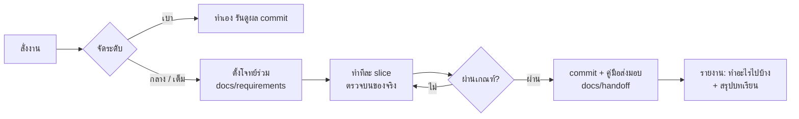

<div align="center">

# agentic-engineering

**ปลั๊กอิน Claude ที่ทำให้ AI เขียนโค้ดแบบมีหลักฐาน ถามก่อนเดา และสอนคุณไปพร้อมงาน**

[](https://github.com/faizbenbenyapol/plugin-agentic-engineering/releases/latest)
[](https://github.com/faizbenbenyapol/plugin-agentic-engineering/actions/workflows/check.yml)
[](https://github.com/faizbenbenyapol/plugin-agentic-engineering/actions/workflows/release.yml)
[](#license)
[](https://code.claude.com/docs/en/plugins)

[ติดตั้ง](#ติดตั้ง) · [ทำงานยังไง](#ทำงานยังไง) · [โหมดสอน](#โหมดสอน-เปิดเป็นค่าเริ่มต้น) · [มีอะไรข้างใน](#มีอะไรในปลั๊กอิน) · [ประวัติการเปลี่ยน](#ประวัติการเปลี่ยน) · [ดาวน์โหลด](https://github.com/faizbenbenyapol/plugin-agentic-engineering/releases)

</div>

---

ทำงานกับ AI แบบ "vibe coding" คือสั่งแล้วรอรับผล โดยไม่รู้ว่า AI ทำอะไรลงไป (กล่องดำ) ปลั๊กอินนี้เปลี่ยนเป็น **agentic engineering**: agent ต้องเก่งและมีวินัย คนสั่งต้องเข้าใจทั้งผลข้างนอกและสิ่งที่เกิดในโค้ด (กล่องใส) และทั้งสองฝ่ายต้องเข้าใจตรงกันว่ากำลังสร้างอะไร

ดัดแปลงจาก [pstack](https://github.com/cursor/plugins/tree/main/pstack) ของ Lauren Tan (Cursor, MIT) ปรับให้คุยภาษาไทยและประหยัดโควตา Claude Pro

## แก้ปัญหาอะไร

| ปัญหาเมื่อใช้ AI เขียนโค้ด | ปลั๊กอินนี้ทำอะไร |
| --- | --- |
| 🎯 **AI เดาความต้องการแล้วทำไปเลย** | ตั้งโจทย์ร่วมก่อนลงมือ ถามเรื่องที่คุณต้องตัดสินพร้อมเหตุผลและคำแนะนำ และถามกลับเมื่อเจอเรื่องที่ไม่ได้ตกลงไว้ |
| ✅ **บอกว่าเสร็จ แต่ไม่ได้ตรวจจริง** | งานยังไม่เสร็จจนกว่าจะรันของจริงให้เห็น ทุกข้ออ้างติดป้าย *รันแล้ว* *อนุมาน* หรือ *เดา* |
| 📖 **ได้โค้ดมาแต่ไม่เข้าใจ** | โหมดสอนเปิดเป็นค่าเริ่มต้น อธิบายทุกการเปลี่ยนว่าเดิมเป็นยังไง ตอนนี้เป็นยังไง และทำไม |
| 🧹 **โค้ดยาว อ่านยาก ช้า และค่อย ๆ พังของเดิม** | เขียนสั้นที่อ่านออกทันที คอมเมนต์ไทยทุกฟังก์ชัน ตัดงานเป็นชิ้นแนวตั้งที่กดลองได้ และรัน test ของเดิมทุกชิ้น |
| 💸 **โควตาหมดเร็ว** | งานเล็กไม่โหลดสกิล ไม่ส่ง agent อ่านไฟล์แบบแคบ แนะนำโมเดลที่คุ้มในแต่ละเฟส และเก็บงานในไฟล์เพื่อ `/clear` ได้ |
| 🗂️ **เข้าใจไม่ตรงกันแล้วไม่มีเอกสารให้อ้าง** | เก็บรีไควร์เมนต์ลง `docs/requirements/` เทียบทุก slice ขอเปลี่ยนต้องถามก่อน และจบด้วยคู่มือส่งมอบ `docs/handoff/` |

## ติดตั้ง

**แอป Claude (desktop)** ดาวน์โหลดไฟล์ `agentic-engineering-vX.Y.Z.plugin` จากหน้า [Releases ล่าสุด](https://github.com/faizbenbenyapol/plugin-agentic-engineering/releases/latest) แล้วเปิดไฟล์ในแอปเพื่อติดตั้ง

**Claude Code** repo นี้เป็น marketplace ในตัว:

```bash
claude plugin marketplace add faizbenbenyapol/plugin-agentic-engineering
claude plugin install agentic-engineering@agentic-engineering
```

หรือพิมพ์ใน session: `/plugin marketplace add faizbenbenyapol/plugin-agentic-engineering` แล้ว `/plugin install agentic-engineering@agentic-engineering`

**ลองจากโฟลเดอร์ในเครื่อง:** `claude --plugin-dir ./plugin-agentic-engineering`

ติดตั้งแล้วสั่งงานตามปกติได้เลย เช่น "เพิ่มระบบคูปองหมดอายุให้ตะกร้า" hook ตอนเริ่ม session จะบอก Claude ให้จัดระดับงานและโหลดสิ่งที่ต้องใช้เอง

## ทำงานยังไง



### ระดับงาน

ทุกครั้งที่เริ่ม session, `/clear` หรือหลัง compact ไฟล์ `hooks/session-context.md` จะถูกฉีดเข้าบริบท บอก Claude ให้จัดระดับงานก่อนแก้ไฟล์แรก:

| ระดับ | ตัวอย่าง | Claude ทำอะไร |
| --- | --- | --- |
| เบา | แก้ข้อความ สี ค่าคงที่ จุดเดียวที่ระบุชัด | ทำเองเลย รันดูผลหนึ่งครั้ง ไม่โหลดสกิล |
| กลาง (ค่าเริ่มต้น) | แก้บั๊ก ฟีเจอร์ทั่วไป รีแฟกเตอร์ | โหลดสกิลหลัก + สกิลสอน + playbook เดียว อัปเดตบอร์ดกลาง แล้วทำเอง |
| เต็ม | เงิน auth ข้อมูลผู้ใช้บน production แก้หลายโมดูล | รอยืนยันสเปก ร่างสองแบบ วิเคราะห์ผลกระทบ และส่ง `reviewer` ตรวจก่อนจบ |

### กฎเหล็กสามข้อ

1. ไม่มีหลักฐานจากของจริง = ยังไม่เสร็จ
2. ห้ามส่งโค้ดที่อธิบายไม่ได้
3. ทุกบรรทัดที่ส่งต้องโยงกลับไปหาหลักฐานได้

### Playbook หนึ่งเล่มต่องาน

ตั้งโจทย์ร่วม · สืบสวน · แก้บั๊ก · ฟีเจอร์ · รีแฟกเตอร์ · prototype · performance · งานใหญ่หลายเฟส · รันยาวจนถึงเงื่อนไข · รับงานต่อ/พักงาน · สร้างสกิลตรวจแอป · แก้นิสัยพลาดซ้ำ · commit · เปิด PR · คู่มือส่งมอบ · ทำงานในทีม/ฝึกงาน · บอร์ดกลาง Whiteboard

### ทีม agent (ใช้เมื่อคุ้มเท่านั้น)

| agent | โมเดล | ใช้เมื่อ |
| --- | --- | --- |
| `scout` | Haiku | ค้นกว้างเกินราว 5 ไฟล์ หรือย่อ log ยาว |
| `implementer` | Sonnet | slice ใหญ่และแยกขาด |
| `reviewer` | Sonnet (งานเสี่ยงสูงใช้ Opus) | บังคับในระดับเต็ม หรือเมื่อผู้ใช้ขอ |

พิมพ์ **"เต็มกำลัง"** เมื่ออยากให้ใช้ agent และ references ได้เต็มที่ในงานนั้น

### หยุดถามก่อนเสมอ

merge เข้า branch หลัก · push หรือเปิด PR ที่ไม่ได้ขอ · force-push · deploy · ลบข้อมูล · migration ที่แตะข้อมูลจริง · ส่งข้อความถึงคนอื่น · ใช้เงิน · แก้ config ระบบจริง

<details>
<summary><b>ตั้งโจทย์ร่วมและถามกลับ (กล่องใส)</b></summary>

<br>

ก่อนลงมือทำฟีเจอร์ งานใหญ่ งานรันยาว หรือคำขอที่ตีความได้หลายแบบ Claude จะทำตาม `playbooks/kickoff.md`:

1. **สำรวจโค้ดก่อน** เพื่อถามเฉพาะสิ่งที่โค้ดตอบไม่ได้ ไม่ถามสิ่งที่หาเองได้
2. **ทวนความเข้าใจ** ว่าทำเพื่อใคร เสร็จแล้วเห็นอะไร และโค้ดส่วนไหนจะถูกแตะ
3. **ถามเป็นรอบ** เรียงตามต้นทุนถ้าเดาผิด ทุกคำถามบอก **ทำไมต้องถาม** มี **ตัวเลือกพร้อมข้อแลกเปลี่ยน** และ **คำแนะนำของ Claude** ตอบ "ตามที่แนะนำ" ได้ เรื่องที่ผิดแล้วแก้ง่ายอย่างสีปุ่ม Claude เลือกเอง เรื่องที่ผิดแล้วแพงอย่าง schema ต้องตกลงก่อน
4. **เขียนไฟล์รีไควร์เมนต์** `docs/requirements/<ชื่องาน>.md`: ทำ / ไม่ทำ / พฤติกรรม / เกณฑ์เสร็จ / แผนเป็นชิ้นแนวตั้ง / ดีไซน์โค้ด / สิ่งที่ Claude ตัดสินเองได้
5. **รอยืนยันหนึ่งครั้ง แล้วทำยาว** โดยไม่หยุดถามเรื่องที่ตกลงแล้ว

ระหว่างทำ Claude แยกความไม่แน่ใจเป็นสามแบบ:

| แบบ | Claude ทำอะไร |
| --- | --- |
| หาเองได้ (ใครเรียกฟังก์ชันนี้) | อ่านหรือรันเอง ไม่ถาม |
| เทคนิคที่ย้อนได้และคุณไม่เห็นความต่าง (ชื่อตัวแปร) | ตัดสินเอง แล้วอธิบายเหตุผลในบล็อกสอน |
| คุณต้องตัดสิน (ฟีเจอร์ ขอบเขต กฎธุรกิจ หน้าตา สถาปัตยกรรม) | ถามพร้อมคำแนะนำ ถ้าคุณไม่อยู่ ใช้ทางที่ย้อนได้แล้วจดเป็นสมมติฐานรอยืนยัน |

ตัวอย่างจากการทดลองจริง: สั่ง "เพิ่มระบบคูปองหมดอายุให้ตะกร้า" Claude ไม่แก้ไฟล์เลย แต่สำรวจโค้ด เจอบั๊กที่มีอยู่ก่อน แล้วถามสามข้อ ได้แก่ คูปองหมดอายุเทียบเวลาแบบไหน คูปองที่ไม่มีวันหมดอายุให้ทำยังไง และบั๊กที่เจอให้แก้รวมในงานนี้ไหม พร้อมร่างข้อตกลงงานให้ยืนยัน

พิมพ์ **"ตัดสินใจเองได้"** เมื่อไม่อยากตอบคำถาม Claude จะใช้ค่าแนะนำ เขียนข้อตกลงให้อ่านก่อนเริ่ม และถามเฉพาะเรื่องที่ย้อนไม่ได้ พิมพ์ **"ถามละเอียด"** เพื่อกลับเป็นค่าเริ่มต้น

</details>

<details>
<summary><b>คุณภาพโค้ด</b></summary>

<br>

ยาวไม่ได้แปลว่าดี เป้าคือโค้ดที่สั้นที่สุดที่ยังอ่านออกทันที ทำงานเร็ว และคนถัดไปแก้ต่อได้โดยไม่พัง กฎทั้งหมดอยู่ใน `skills/agentic-engineering/references/code-quality.md` เมื่อเป้าหมายขัดกัน ลำดับคือ **ถูกต้อง > อ่านง่ายและดูแลง่าย > เร็ว**

- **สะอาดและกระชับ:** ไม่มีโค้ดเผื่อ ฟังก์ชันทำเรื่องเดียว early return แทน if ซ้อน ชื่อบอกความหมายและหน่วย ไม่มีตัวเลขลอย
- **ประสิทธิภาพที่ทำเสมอ:** `Set`/`Map` เมื่อค้นบ่อย ไม่ query DB หรือเรียก API ใน loop ทำ IO ที่ไม่ขึ้นต่อกันพร้อมกัน
- **ประสิทธิภาพที่ต้องวัดก่อน:** cache, memoize, micro-optimization ทำเมื่อมีตัวเลขบอกว่าช้า
- **ดูแลต่อได้:** แยก logic ธุรกิจออกจาก IO และ UI ตรวจข้อมูลที่ขอบระบบ ห้าม catch เปล่า ไม่ hardcode config หรือ secret
- **จับนิสัย slop:** ไม่ครอบ try/catch กว้าง ๆ ให้ test ผ่าน ไม่ cast บังคับ type ไม่ก๊อปสูตรไปแปะอีกที่
- **คอมเมนต์ภาษาไทย** ทุกฟังก์ชันที่เพิ่มหรือแก้ บอกว่าทำอะไร รับ/คืนอะไร ผลข้างเคียง และข้อควรระวัง ห้ามคอมเมนต์ทวนโค้ดทีละบรรทัด

```ts
/**
 * คิดยอดรวมสุทธิของตะกร้าหลังหักส่วนลด
 * @param items สินค้าในตะกร้า ว่างได้ (คืน 0)
 * @param coupon คูปองที่ผ่านการตรวจแล้ว หรือ null ถ้าไม่ใช้
 * @returns ยอดสุทธิเป็นสตางค์ ไม่ติดลบ
 * @throws CouponExpiredError ถ้าคูปองหมดอายุระหว่างคิดเงิน
 */
export function calcTotalSatang(items: CartItem[], coupon: Coupon | null): number {
  // รวมสินค้าซ้ำก่อน เพราะส่วนลดขั้นบันไดคิดจากจำนวนต่อรายการ
  const merged = mergeDuplicates(items);
  ...
}
```

</details>

## โหมดสอน (เปิดเป็นค่าเริ่มต้น)

เป้าหมายคือจบงานแล้วคุณอธิบายได้ด้วยคำของตัวเองว่าแก้อะไร ตรงไหน ทำไม และแนวคิดใหม่ทำงานยังไง Claude พูดในสามจังหวะ:

| จังหวะ | ได้อะไร |
| --- | --- |
| **ก่อนลงมือ: แผนที่งาน** | ไฟล์ไหนทำหน้าที่อะไร ข้อมูลไหลยังไง (มีแผนภาพเมื่อมี 3 ส่วนขึ้นไป) และจะทำกี่ขั้น |
| **ระหว่างทำ** | บอกก่อนแก้ว่าจะแก้อะไรและทำไม อ่านผล test หรือ error ให้ฟัง และบล็อก "เรียนไปด้วย" เมื่อเจอแนวคิดใหม่ |
| **จบงาน: ทำอะไรไปบ้าง** | ทุกการเปลี่ยนบอก ที่ไหน → ก่อน → หลัง → ทำไม แล้วชี้ **จุดที่ควรอ่านเอง** ปิดด้วยสรุปบทเรียน |

```
เรียนไปด้วย: หน่วงเวลาก่อนทำงาน (debounce)
- อยู่ตรงไหน: แก้ช่องค้นหายิง API รัว ขั้น 2/4 (กำลังแก้ input)
- ปัญหาที่มันแก้: พิมพ์ "shoes" ระบบยิง API 5 ครั้ง ครั้งละตัวอักษร
- มันคืออะไร: รอให้ผู้ใช้หยุดพิมพ์สักพักก่อนค่อยทำงานครั้งเดียว
- ทำงานยังไง: พิมพ์ "s" → ตั้งนาฬิกา 300ms → พิมพ์ "h" ก่อนครบ → ยกเลิกนาฬิกาเดิม ตั้งใหม่ ...
- ในโค้ดของเรา: search/input.ts:14 ...
- ทำไมเลือกแบบนี้: ทางง่ายกว่าคือมีปุ่ม "ค้นหา" แต่ผู้ใช้อยากเห็นผลระหว่างพิมพ์
- พลาดบ่อย: ลืมยกเลิกนาฬิกาตอน component ถูกปิด ทำให้ยิง API หลังออกจากหน้าแล้ว
```

ความลึกมีสามระดับ: **สั้น** (รายงานย่อ) · **ปกติ** (ค่าเริ่มต้น ครบสามจังหวะ) · **ละเอียด** (อธิบายทีละบรรทัด รันตัวอย่างให้ดู และเปิดสมุดบันทึก) ระดับปกติขึ้นไปใช้โควตามากกว่า เป็นการแลกที่ตั้งใจไว้

<details>
<summary><b>คำสั่งที่พิมพ์ได้</b></summary>

<br>

| พิมพ์ | ผล |
| --- | --- |
| "สอนสั้น" / "สอนปกติ" / "สอนละเอียด" | เปลี่ยนความลึก (บอก "จำไว้" ถ้าอยากให้ใช้ทุก session) |
| "ถามละเอียด" / "ตัดสินใจเองได้" | เปลี่ยนว่าจะให้ Claude ถามก่อนลงมือแค่ไหน |
| "ปิดโหมดสอน" / "เปิดโหมดสอน" | ปิดหรือเปิดการสอน |
| "ขยาย" | อธิบายเรื่องล่าสุดลึกขึ้นหนึ่งชั้น |
| "ง่ายกว่านี้" | อธิบายใหม่จากจุดที่ติด โดยไล่ค่าจริงผ่านโค้ด |
| "อธิบายที่ทำไป" | เขียน "ทำอะไรไปบ้าง" ฉบับเต็มของงานล่าสุด |
| "อธิบายไฟล์นี้" | ภาพรวม → ข้อมูลไหลยังไง → ทำไมเป็นแบบนี้ |
| "ทวนที่เรียน" | สรุปแนวคิดที่เคยเรียนในโปรเจกต์นี้ |
| "ทดสอบฉัน" | ถาม 3–5 ข้อจากโค้ดของคุณเอง |
| "ให้ฉันลองเขียน" | Claude เว้นชิ้นเล็กไว้เป็น `TODO(human)` ให้คุณเขียน แล้วรันตรวจให้ |
| "จดบันทึก" / "เก็บบันทึก" | เปิดสมุดบันทึก / commit สมุดขึ้น branch งาน |
| "ซิงก์บอร์ด" / "ปิดบอร์ด" / "เปิดบอร์ด" | จัดการบอร์ดกลาง Whiteboard |

</details>

<details>
<summary><b>สมุดบทเรียน</b></summary>

<br>

- `~/.claude/learning/profile.md` โปรไฟล์ผู้เรียน (ระดับ ความลึกที่ชอบ แนวคิดที่คล่องแล้ว) บนคลาวด์เก็บที่ `.learning/profile.md`
- `.learning/concepts.md` แนวคิดที่เจอในโปรเจกต์นี้ และสถานะ เพิ่งเจอ → เริ่มเข้าใจ → คล่อง
- `.learning/journal.md` บันทึกรายงาน เมื่อสั่ง "จดบันทึก" หรือระดับละเอียด

`.learning/` ถูกใส่ใน `.git/info/exclude` จึงไม่ติดไปกับ commit จนกว่าจะสั่ง "เก็บบันทึก"

</details>

## มีอะไรในปลั๊กอิน

```
.claude-plugin/
  plugin.json            ข้อมูลปลั๊กอินและเลขเวอร์ชัน (ต้นทางเดียวของเวอร์ชัน)
  marketplace.json       ทำให้ repo นี้ติดตั้งผ่าน marketplace ได้
hooks/
  hooks.json             hook ตอนเริ่ม session
  session-context.md     กฎสั้น ๆ ที่ถูกฉีดทุก session
skills/
  agentic-engineering/   สกิลหลัก: กฎเหล็ก งบโควตา ระดับงาน รายงานจบงาน
    playbooks/           วิธีทำงานแต่ละแบบ 17 เล่ม
    references/          เปิดเมื่อจำเป็น (code-quality, reporting, verification, design, principles, ...)
    scripts/log.sh       บันทึกการตัดสินใจในงานรันยาว
  learn-while-building/  โหมดสอน
  anti-ai-ui/            แนวทาง UI ที่ไม่ดูเหมือนงาน AI + typography ภาษาไทย
agents/                  implementer, reviewer, scout

ของคนดูแล repo (ไม่อยู่ในไฟล์ .plugin)
.github/workflows/       check (ตรวจทุก PR) และ release (ออก release หลัง merge)
scripts/                 check-release, release-notes, build-plugin, sync-agents
docs/                    รีไควร์เมนต์และบอร์ดของงานที่ทำกับ repo นี้
CLAUDE.md                กฎของ repo สำหรับคนและ AI
```

## แนะนำการใช้กับ Pro

- `/model sonnet` เป็นค่าประจำ ใช้ `/model opusplan` กับงานออกแบบหนัก Claude จะบอกเองตอนเปลี่ยนเฟสว่าควรใช้โมเดลไหน
- หลังรีไควร์เมนต์ได้รับยืนยัน `/clear` แล้วสั่ง "ทำงานต่อตาม docs/requirements/<ชื่อ>.md" ถูกกว่าแบกแชทยาวต่อ
- `/clear` เมื่อเปลี่ยนเรื่อง และ `/usage` เพื่อดูว่าสกิล agent หรือปลั๊กอินไหนกินโควตา

## ออกเวอร์ชันใหม่

ทุกเวอร์ชันมี GitHub Release ของตัวเองพร้อมไฟล์ `.plugin` โดยอัตโนมัติ ขั้นตอนเต็มและสิ่งที่ CI ตรวจอยู่ใน [`CLAUDE.md`](CLAUDE.md)

1. ใน PR เดียวกัน ขยับ `version` ใน `.claude-plugin/plugin.json` เขียนหัวข้อ `### X.Y.Z` ใน [ประวัติการเปลี่ยน](#ประวัติการเปลี่ยน) และแก้หัว `SKILL.md` เป็น `(vX.Y ...)`
2. workflow `check` ตรวจให้ ถ้าลืมข้อไหน PR จะแดงพร้อมบอกวิธีแก้ (รันเองก่อนได้: `scripts/check-release.sh origin/main`)
3. merge เข้า `main` แล้ว workflow `release` สร้าง tag `vX.Y.Z` ออก release ใช้ข้อความในประวัติการเปลี่ยนเป็นโน้ต และแนบไฟล์ `.plugin`

เรื่องอื่นของคนดูแล: แก้ `agents/*.md` แล้วรัน `scripts/sync-agents.sh` · ตรวจโครงสร้างด้วย `claude plugin validate .` · ถ้าตั้ง env `CLAUDE_CODE_EFFORT_LEVEL` ไว้ จะทับ effort ของ agent

## ประวัติการเปลี่ยน

ดาวน์โหลดไฟล์ติดตั้งของแต่ละเวอร์ชันได้ที่ [Releases](https://github.com/faizbenbenyapol/plugin-agentic-engineering/releases) ข้อความใต้หัวข้อแต่ละเวอร์ชันคือโน้ตของ release นั้น

### 0.15.0

ปรับจากทอล์ก "12 Rules for a Software Factory That Doesn't Ship Slop" ของ Dex Horthy และผลวัด SlopCodeBench (AI ทำฟีเจอร์ใหม่ผ่าน 66–74% แต่ผ่านครบทั้งของใหม่และของเดิมแค่ราว 16%)

- **ชิ้นแนวตั้ง (vertical slice) แทนการทำทีละชั้น:** `playbooks/feature.md` เลิกกฎ "logic/ข้อมูลก่อน แล้วค่อยต่อ UI" slice แรกบางแต่ทะลุทุกชั้นจนกดลองได้ แล้วค่อยต่อ API และฐานข้อมูล ขนาด slice ให้ diff ราว 100–200 บรรทัด ข้อมูลปลอมใน slice แรกต้องติดป้าย `ชั่วคราว:` และถูกลบใน slice ที่ต่อของจริง
- **ของเดิมต้องไม่พัง:** ทุก slice รัน test ของฟีเจอร์เดิมที่แตะ REQ ที่เคยผ่านแล้วกลับพังนับเป็นไม่ผ่าน (feature, kickoff, SKILL.md ข้อ 4)
- **ลึกแค่ไหนดูความเจ็บที่คาดไว้:** kickoff ใช้ "โอกาสต้องแก้ × แก้แล้วเจ็บแค่ไหน" ตัดสินว่าต้องถามหรือปล่อยให้ AI เลือก schema รูปข้อมูลถาวร API ที่คนอื่นเรียก และกฎเงินต้องตกลงก่อนเขียน ข้อตกลงงานเพิ่มบรรทัด "ดีไซน์โค้ด" (ชื่อฟังก์ชัน รับ คืน ไฟล์ที่เพิ่ม/แก้)
- **แสดงแทนบรรยาย:** คำถามเรื่องหน้าตาหรือรูปของระบบให้โชว์ mockup ตาราง หรือแผนภาพแทนกำแพงตัวหนังสือ
- **ห้ามส่ง slop:** นิยาม slop และด่าน "ผู้รับต้องเหนื่อยกว่าเราไหม" ใน SKILL.md ข้อ 5 และ PR; รายงานจบงานเพิ่ม **จุดที่ควรอ่านเอง** และหลักฐานต้องเป็นแคปจอ วิดีโอ หรือ output จริง ไม่ใช่แค่ "test ผ่าน"
- **เช็กก่อนส่งจับนิสัย slop:** try/catch กว้าง ๆ, cast บังคับ type, ก๊อปสูตรไปแปะ (`references/code-quality.md`)
- prototype ที่ต้องให้ผู้ใช้จริงตอบ ซ่อนหลัง feature flag (เปิดให้ผู้ใช้จริงต้องถามก่อน), ชุดกฎ lint สำเร็จรูปก่อนเขียนเอง, จดการตัดสินใจข้างโค้ด, หลักการ "รู้จักศัตรู" ใน `references/principles.md`

### 0.14.0

- **เพิ่ม `playbooks/board.md` บอร์ดกลางระหว่างผู้ใช้กับ AI:** หนึ่งบอร์ด Whiteboard ต่อหนึ่งโปรเจกต์ มี 4 ส่วน (แผนที่ระบบ, งานปัจจุบัน, บันทึกการเปลี่ยนแปลง, คำถามเปิด) สี 4 แบบ (ของเรา / แตะล่าสุด / ภายนอก / โน้ต) สร้างก่อนแก้ไฟล์แรกของงานระดับกลางขึ้นไป และอัปเดตเฉพาะส่วนที่เปลี่ยนทุก slice ที่เสร็จ วาดจากโค้ดจริงที่เปิดดู ลิงก์และตาราง id เก็บใน `docs/board.md`
- **ทางสำรองเมื่อเซสชันไม่มีเครื่องมือ artifact** (เช่น Claude Code ในเทอร์มินัล): อัปเดต `docs/system-map.md` (Mermaid) จดค้างใน `docs/board.md` แล้วสั่ง "ซิงก์บอร์ด" จากแชท Claude ภายหลัง ห้ามรายงานว่าอัปเดตแล้วถ้าไม่ได้เขียนจริง
- รายงาน "เสร็จขั้นที่ x/y" และรายงานจบงานมีบรรทัดบอร์ด; repo ของทีมต้องถามก่อนเก็บแผนผังระบบใน Claude และ exclude ไฟล์บอร์ด

### 0.13.0

- **ย่อ hook ตอนเริ่มเซสชันเหลือราวหนึ่งในสาม:** เหลือแค่เงื่อนไขว่าเมื่อไรต้องโหลดสกิล กฎขั้นต่ำของงานเบา และกติกา repo ทีม รายละเอียดที่เหลืออยู่ใน SKILL.md ซึ่งโหลดเมื่อทำงานจริง ประหยัดโทเค็นทุกเซสชัน รวมแชทที่ไม่ได้เขียนโค้ด
- **ลำดับเมื่อกฎขัดกัน:** คำสั่งผู้ใช้ > กติกาทีม > สกิลนี้ > สกิลอื่น (เช่น `ponytail` ไม่ลดการสอนหรือรายงาน)
- **รวมกฎ "ไม่ทำเกินโจทย์" จาก `thai-function-comments` เข้า `references/code-quality.md`** ส่วนเรื่องคอมเมนต์ภาษาไทยมีครบอยู่แล้ว จึงปิดสกิลนั้นได้โดยไม่เสียอะไร

### 0.12.0

- **เพิ่ม `playbooks/team-work.md` สำหรับทำงานในทีม บริษัท และฝึกงาน:** ถามนโยบาย AI ของบริษัทก่อน, สำรวจกติกาทีมแล้วจดลง `docs/team-rules.md`, เก็บไฟล์ส่วนตัวของสกิลไว้ใน `.git/info/exclude` ไม่หลุดเข้า repo ทีม, ถามเจ้าของ ticket แทนการเดา, เตือนให้ถามทีมเมื่อติดเกิน 45 นาที, ตาม main ทุกวันและแก้ conflict โดยไม่ทิ้งงานคนอื่น, ขอบเขตเท่ากับ ticket, ซ้อมรีวิวถามผู้ใช้ 3 ข้อก่อนเปิด PR, รับคอมเมนต์รีวิวทีละข้อ, ร่าง standup และข้อความถึงทีมให้ผู้ใช้ส่งเอง
- **กติกาทีมชนะค่าเริ่มต้น:** ใน repo ของทีม ภาษาคอมเมนต์ commit PR และ style ตามทีม (SKILL.md, hook, code-quality, delivery, pull-request) ส่วนการคุยและการสอนยังเป็นภาษาไทย
- รายการหยุดรอยืนยันเพิ่ม: ตอบคอมเมนต์ PR แก้ ticket หรือโพสต์แชททีมในนามผู้ใช้, เพิ่มหรืออัปเกรด dependency หรือแก้ CI ใน repo ทีม

### 0.11.0
- **เล่าทีละขั้นที่ทำเสร็จ:** จบแต่ละขั้นหรือ slice ส่ง "เสร็จขั้นที่ x/y" ทันทีด้วยภาษาธรรมดา (ทำอะไรไป แปลว่าอะไรสำหรับผู้ใช้ รู้ได้ยังไงว่าใช้ได้ ต่อไปทำอะไร) ทุกระดับงาน แม้ปิดโหมดสอน
- **รายงานจบงานเปิดด้วย "สรุปสั้น ๆ"** 2–4 ประโยคที่ไม่มีชื่อไฟล์หรือศัพท์ที่ยังไม่อธิบาย ก่อนรายละเอียดเทคนิค พร้อมเช็กว่าคนที่ไม่ได้ดูงานอ่านรู้เรื่อง
- **commit และ PR:** หัวข้อภาษาอังกฤษ (Conventional Commits) รายละเอียดภาษาไทยตามโครง ปัญหา / แก้ยังไง / ตรวจยังไง หัวข้อใน PR body เป็นภาษาไทย trailer คงภาษาอังกฤษ ยกเว้น repo กำหนดภาษาไว้ชัด กฎนี้อยู่ใน hook ด้วยจึงใช้กับงานเบา
- แก้รายชื่อ playbook ใน SKILL.md ให้ครบ 15 เล่ม (เพิ่ม `correct` และ `pull-request`)
- **รูปแบบรายงานมีแหล่งเดียว:** ย้ายรูปแบบ "เสร็จขั้นที่ x/y", "สรุปสั้น ๆ", "ทำอะไรไปบ้าง" (ฉบับเต็มและฉบับย่อ) และลำดับรายงานจบงาน ไปไว้ที่ `references/reporting.md` ส่วน SKILL.md, `learn-while-building`, `writing.md` และ `commands.md` ชี้มาที่ไฟล์นี้ hook เก็บฉบับย่อไว้ให้งานเบา
- **ขั้นเริ่มงานเป็นลำดับ 5 ขั้น:** ทวนและจัดระดับ → อ่าน playbook, code-quality, reporting → ตั้งโจทย์ร่วมถ้าเข้าเงื่อนไข → ทำตาม playbook → ปิดงาน แทนย่อหน้าเดียวยาว

### 0.10.0
- **รีไควร์เมนต์ในรีโป:** kickoff ถามเป็นรอบแบบต้นไม้การตัดสินใจ (จาก `grilling` ของ mattpocock) จนไม่เหลือเรื่องที่ต้องเดา แล้วเขียน `docs/requirements/<ชื่องาน>.md` ตามแม่แบบใหม่ `references/requirements-template.md` (REQ/EDGE พร้อมเกณฑ์ยอมรับ ไม่ทำรอบนี้ คำถามเปิด แผนพร้อมโมเดล ประวัติการเปลี่ยน)
- **ด่านตรวจรีไควร์เมนต์:** เทียบทุก slice กับ REQ ที่ครอบคลุม จะทำต่างจากไฟล์ต้องออก "คำขอเปลี่ยน (CR)" และรออนุมัติก่อน reviewer ตรวจแกนสเปกแยกจากแกนพัง (จาก code-review ของ mattpocock/vtno)
- **คู่มือส่งมอบ:** `playbooks/handoff.md` ทำทุกงานระดับกลางขึ้นไป ไฟล์ `.md` มีตารางตรวจย้อนรีไควร์เมนต์ การติดตั้ง env การใช้งาน โครงสร้าง การทดสอบ rollback และขั้นที่ผู้ใช้ต้องทำเอง (แนวคิดจาก `wizard`/`handoff` ของ mattpocock และ AI-native SDLC playbook) ประกอบจาก artifact ที่มีเพื่อไม่ให้กินโควตา
- **แผนโมเดล:** `references/model-routing.md` ตารางเฟส → โมเดล จุด `/clear` พร้อมข้อความเริ่มใหม่ และตารางปรับวิธีของ pstack (โทเค็นไม่จำกัด) ให้เข้ากับ Pro
- **UX/UI:** `anti-ai-ui` เพิ่มขั้น 0 UX ก่อนหน้าตา (`references/ux-flow.md`: flow งานหลัก ตารางสถานะ เช็กลิสต์ 10 ข้อ ฟอร์มและข้อมูลไทย microcopy) และ `references/variants.md` ทำ 2–3 แบบให้สลับดูบนหน้าจริง (ดัดแปลงจาก prototype ของ mattpocock) เทียบ screenshot กับภาพที่อนุมัติ (จาก AI-native SDLC playbook) และ microcopy จาก frontend-design ของ Anthropic
- ฟีเจอร์สร้างจากชั้นในออกนอก interface ตามผู้เรียก fake ที่เขียนเอง (จาก engineering-rules ของ vtno)
- สื่อสารภาษาไทยเป็นกฎบนสุดของสกิลและ hook
- ตรวจทานตัวเองก่อนปล่อย: kickoff ระดับกลางถามไม่เกิน 2 รอบ, รีไควร์เมนต์มีฉบับย่อ/เต็ม, งานแก้บั๊กไม่สร้างคู่มือใหม่ทุกครั้ง (ต่อท้ายคู่มือเดิมหรือ CHANGELOG), รายงานในแชทสรุป REQ เป็นตัวเลขแทนการพิมพ์ตารางซ้ำ, สลับโมเดลคู่กับ `/clear` เท่านั้นเพราะแคชผูกกับโมเดล, งาน UI เล็กข้ามขั้น flow

### 0.9.0
- เพิ่ม `playbooks/kickoff.md` ตั้งโจทย์ร่วมก่อนลงมือ: สำรวจโค้ดก่อนถาม, ทวนความเข้าใจ, ถามเป็นรอบพร้อมเหตุผล ตัวเลือก และคำแนะนำ, เขียนข้อตกลงงาน แล้วรอยืนยันครั้งเดียวก่อนทำยาว
- กฎถามกลับระหว่างทาง: แยกความไม่แน่ใจเป็นหาเองได้ / เทคนิคที่ย้อนได้ / ผู้ใช้ต้องตัดสิน งานนอกข้อตกลงต้องถาม "อันนี้ทำด้วยไหม"
- เปลี่ยนกฎเดิมที่เอียงไปทาง "ลงมือก่อนถามทีหลัง": ฟีเจอร์ทุกระดับต้องตั้งโจทย์ร่วม (เดิมเฉพาะระดับเต็ม), บั๊กที่พฤติกรรมที่ถูกไม่ชัดต้องถาม, หลักการ "ไม่หยุดรอมนุษย์" ใช้กับเรื่องเทคนิคหลังตกลงโจทย์แล้วเท่านั้น
- รายงานจบงานเพิ่ม "ใครตัดสินอะไร" และเกณฑ์เสร็จทีละข้อ, คำสั่ง "ถามละเอียด" / "ตัดสินใจเองได้"
- ทดลองกับคำขอฟีเจอร์ที่กำกวม: Claude ถาม 3 ข้อพร้อมร่างข้อตกลง และไม่แก้ไฟล์ก่อนได้คำตอบ

### 0.8.0
- เพิ่ม `references/code-quality.md`: โค้ดสะอาดและกระชับ ประสิทธิภาพที่ทำเสมอกับที่ต้องวัดก่อน คอมเมนต์ภาษาไทย การดูแลระยะยาว และเช็กก่อนส่ง
- เปลี่ยนกฎคอมเมนต์จาก "เฉพาะทำไม" เป็นคอมเมนต์ภาษาไทยทุกฟังก์ชัน (ทำอะไร รับ/คืนอะไร ผลข้างเคียง) พร้อมหัวไฟล์และหัวช่วง logic แต่ยังห้ามทวนโค้ดทีละบรรทัด
- hook ใส่กฎคุณภาพโค้ดสั้น ๆ ให้ใช้กับงานเบาด้วย
- implementer เขียนตามคู่มือและทำเช็กก่อนส่งก่อน commit, reviewer รายงานปัญหาคุณภาพโค้ดเป็นหัวข้อแยก
- โหมดสอนอธิบายเหตุผลด้านประสิทธิภาพด้วยตัวอย่างขนาดข้อมูลจริง

ปรับหลังตรวจทั้งปลั๊กอินและทดลองรันงานแก้บั๊กจริง 4 รอบ:
- ทดลองพบว่า Claude ไม่เปิดไฟล์ playbook และคู่มือคุณภาพโค้ดเลย ขั้นเริ่มงานจึงสั่งให้อ่านทั้งสองก่อนแก้ไฟล์แรก (รอบถัดมาอ่านครบ)
- ทดลองพบว่างานที่ดูง่ายข้ามแผนที่งานและบล็อกสอน มีแค่สรุปบทเรียนตอนท้าย จึงเพิ่มด่านตรวจก่อนส่งรายงาน (รอบถัดมาสอนครบ)
- agent ทำงานในโฟลเดอร์โปรเจกต์จึงหาคู่มือคุณภาพโค้ดไม่เจอ brief ต้องแนบ path เต็ม และ agent มีกฎย่อสำรอง
- รวมรายละเอียดที่มีประโยชน์จากสกิล thai-function-comments เข้าคู่มือ: ข้อยกเว้น, ห้ามแปลชื่อฟังก์ชัน, รูปแบบตามภาษา, ข้อความ log และ error ยังเป็นภาษาอังกฤษ
- โค้ดทิ้งของ prototype ได้รับยกเว้นกฎคุณภาพโค้ด, จุดช้าในโค้ดเดิมที่ไม่ได้แตะให้เสนอในรายงานแทนแก้, เรื่องโค้ดซ้ำให้ตรงกับ principles
- ย้ายตารางคำสั่งของโหมดสอนไปไฟล์ `references/commands.md` ลดสิ่งที่โหลดทุกงาน
- แก้ตัวชี้ผิด: โครง PR อยู่ใน `pull-request.md`, tells.md ให้อ่านเฉพาะหมวด, principles ไม่บังคับอ้างชื่อหลักการ

### 0.7.0
- ผู้ใช้แจ้งว่าการสอนและคำอธิบายสิ่งที่ทำสั้นเกินจนไม่เข้าใจ จึงเปลี่ยนโหมดสอนจากบล็อก 3 บรรทัดตอนจบ เป็นสอนระหว่างทางเป็นค่าเริ่มต้น
- งานระดับกลางขึ้นไปโหลด `learn-while-building` ทุกครั้ง: แผนที่งาน, พากย์ "จะทำอะไร ทำไม ผลแปลว่าอะไร", บล็อกสอนแนวคิดที่บอกปัญหา กลไก ค่าจริง และ `file:บรรทัด`
- รายงานจบงานเพิ่มหัวข้อ "ทำอะไรไปบ้าง" (ก่อน→หลัง→ทำไม ทีละการเปลี่ยน) ทุกงานโค้ด รวมงานเบาและตอนปิดโหมดสอน
- ระดับความลึกเป็น สั้น / ปกติ / ละเอียด เลิกเพดาน 8 บรรทัด และห้ามตัดคำอธิบายเพื่อประหยัดโควตา
- implementer รายงาน ก่อน→หลัง→ทำไม ของทุกจุดที่แก้ เพื่อให้หัวหน้าอธิบายต่อได้
- เพิ่ม `marketplace.json` ให้ติดตั้งจาก GitHub ได้

### 0.6.x
- ทดสอบจริงพบว่างานบั๊กและฟีเจอร์ไม่โหลดสกิล จึงกำหนดให้เรียกสกิลก่อนแก้ไฟล์แรก และจำกัดงานเบาให้ชัด
- คืน `resume` ให้ hook และแก้ path ใน deep-teaching
- งาน production ด้านเงิน auth หรือข้อมูลผู้ใช้ต้องส่ง `reviewer` ก่อนจบ เพราะการทดสอบพบว่าข้ามได้

### 0.6.0
- ย้ายรายละเอียดทีม การตรวจ และการตั้งโปรเจกต์ออกจากสกิลหลัก เพื่อไม่ให้ค้างในบริบททุก request
- เซสชันหลักเขียนโค้ดเองเป็นค่าเริ่มต้น ลดการส่ง agent ลดการใช้ Opus และจำกัดประลองกับแตกงานไว้เมื่อผู้ใช้สั่ง
- เลิกบังคับก๊อปขั้นลง task list, สเปกเป็นไฟล์ในงานระดับกลาง และการอ้างชื่อหลักการในรายงาน
- โหมดสอนย้ายเป็นบล็อกสั้นตอนจบงาน แยกโหมดละเอียดและ journal เป็นทางเลือก
- แยกขั้นตอน PR ออกจาก `delivery.md` เพิ่มเพดานรอบในงานรันยาว และลดการใช้ screenshot
- บนคลาวด์ให้ push branch งานก่อนจบ และเก็บโปรไฟล์ผู้เรียนใน repo

### 0.5.0
- เพิ่มสกิล `learn-while-building` และเชื่อมกับ agentic-engineering (จังหวะสอนตาม playbook, หัวข้อ "สรุปบทเรียน" ท้ายรายงาน)
- implementer รายงานเทคนิคที่เกินพื้นฐานกลับมาให้หัวหน้าใช้สอน
- ปรับจากการทดลองจริง: ไม่เล่าต้นเหตุซ้ำระหว่างบล็อกสอนกับรายงาน, งานเล็กสอนไม่เกิน 2 บล็อก, ติดป้ายครั้งเดียวต่อบล็อก, ตัดสินระดับจากความเสี่ยงของการเปลี่ยน

### 0.4.0
- เพิ่ม playbook: performance, งานใหญ่, รันยาวจนจบ, รับงานต่อ/พักงาน, สร้างสกิลตรวจ, แก้นิสัยพลาดซ้ำ, ส่งมอบ
- เพิ่มตัวกระตุ้น, บันไดความมั่นใจ 5 ขั้น, คำตัดสิน 3 แบบ
- reviewer เปลี่ยนเป็นแบบโจมตีที่ต้องพิสูจน์ทุกข้อด้วยการรัน
- แยกรายละเอียดออกเป็น playbooks/ และ references/
- รายการหยุดรอยืนยันเหลือรายการเดียว, ขั้นส่งมอบ commit ในเครื่องเป็นค่าเริ่มต้น, คืนกฎ "สถาปัตยกรรมเป็นของมนุษย์" และ "ใช้ของที่มีก่อน"
- `log.sh` ปลอดภัยเมื่อหลาย agent เขียนพร้อมกัน, `sync-agents.sh` ไม่ทำไฟล์เสียเมื่อล้ม

## แหล่งที่มา

- pstack โดย Lauren Tan (poteto), Cursor, MIT License, v0.15.36: https://github.com/cursor/plugins/tree/main/pstack (ตัวกระตุ้น, playbook ทั้งหมด, หลักการ 24 ข้อ, architect, arena, interrogate, blast-radius, correct, show-me-your-work, benchmark-checklist, create-verification-skill)
- Karpathy: agentic = กำกับ agent แทนเขียนเอง, engineering = ทักษะที่ฝึกได้
- Mitchell Hashimoto (Ghostty): ห้ามส่งโค้ดที่อธิบายไม่ได้, โชว์เหตุผลไม่ใช่แค่ diff
- Daniel Stenberg (curl): รายงานบั๊กจาก AI ที่ไม่ได้ตรวจ ฟังดูมั่นใจแต่ทำซ้ำไม่ได้ → ติดป้ายทุกข้ออ้าง
- GitClear 2025 / LeadDev: โค้ดก๊อปซ้ำเพิ่ม การรีแฟกเตอร์ลด → ใช้ของเดิมก่อนเขียนใหม่
- John Ousterhout, A Philosophy of Software Design (deep modules, red flags); Alistair Cockburn, Hexagonal Architecture
- YouTube "ผมเลิก vibe coding แล้วครับ" (TinoThamTech): https://youtu.be/KWo_sZWrs3Y
- Claude Code subagents (ฟิลด์ model, effort, tools, isolation): https://code.claude.com/docs/en/sub-agents

- Matt Pocock, skills (MIT): https://github.com/mattpocock/skills (grilling, to-spec, prototype UI, handoff, wizard, code-review สองแกน)
- vtno/skills: https://github.com/vtno/skills (engineering-rules, implement)
- Anthropic, skills (Apache-2.0): https://github.com/anthropics/skills (frontend-design: microcopy และเกณฑ์งานเว็บ)
- Anthropic, The AI-native SDLC playbook: https://claude.com/resources/articles/the-ai-native-sdlc-playbook (intent/spec/plan ใน repo, อัปเดตแผนเมื่อเปลี่ยน, เทียบ UI กับ mock ที่อนุมัติ, agent หยุดก่อนประตู production)

## License

MIT
